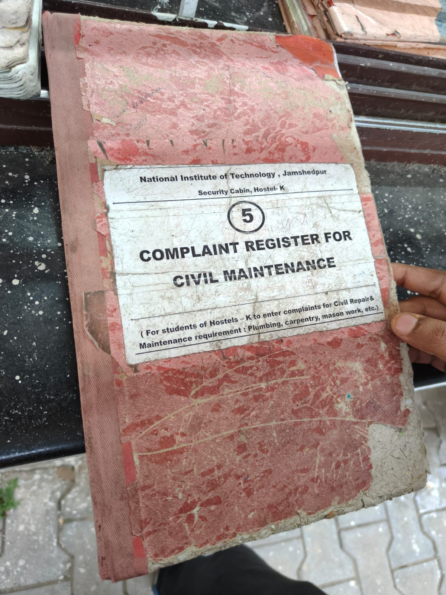
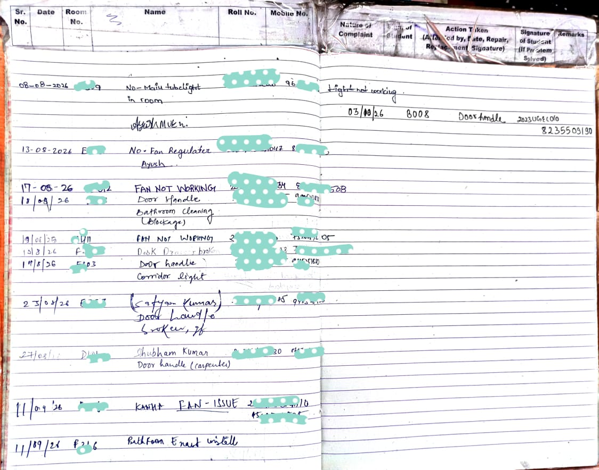
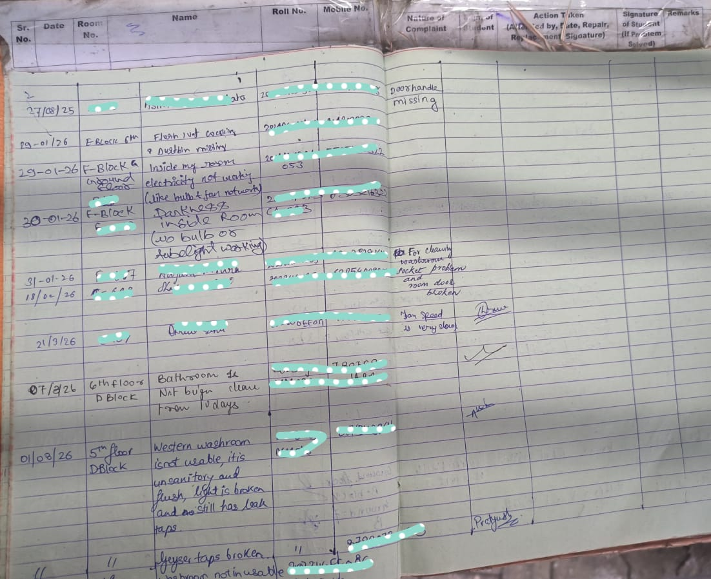

# Fieldwork: Hostel Maintenance Demand & Dispatch

## 1. Location and Observation

- **Place:** Hostel Guard Office, Hostel K , NIT Jamshedpur
- **Date of visit:** November 17, 2026
- **Observation duration:** 35 minutes (7:00 PM – 7:35 PM)
- **Person interviewed:** [Mr. Manoj Kumar]
- **Role:** Hostel Supervisor

### What I Observed On-Site

1. **Multiple Fragmented Registry Books:** The desk had separate handwritten registers for civil/sanitation, electrical, and carpentry complaints. Some students wrote electrical issues in the civil book if the electrical register was in use.
2. **Scattered Geographic Distribution:** In 74 consecutive entries, complaints span across 6 distinct blocks (A through F) and 6 different floors (Ground through 6th floor).
3. **Pervasive Duplicate Logging:** Students repeatedly log the exact same issue when it isn't fixed immediately. For example, room `E303` has three separate entries (`C019`, `C022`, `C023`) within five days for the exact same broken door handle.
4. **Availability Mismatch:** Students often write availability windows in the margins (e.g., "after 8pm", "8:00 AM to 2 PM", "anytime", or "not present"). When technicians arrive mid-afternoon (2:00 PM – 4:00 PM), many rooms are locked because students are in classes.
5. **Vague & Compounded Descriptions:** Many entries list combined trades in a single row (e.g., `C050`: "No light in washroom, need 4 tube lights. No Table, No Tubelight. No bulb in room 246", spanning both Electrical and Carpentry).

---

## 2. Conversation with the Target Person

- **Person interviewed:** Manoj Kumar
- **Role:** Hostel Supervisor 
- **Interview Time:** 7:00 PM, November 17, 2026

### Three Important Things I Learned

1. **The Threshold Bottleneck:** Technicians (plumbers, carpenters, electricians) are contractors shared across university buildings. The supervisor cannot summon an electrician for a single fused bulb in B309—he has to wait until 4 to 5 electrical complaints accumulate to justify calling the contractor for a 2-hour visit.
2. **Vertical Backtracking Exhaustion:** When a technician arrives without a pre-sorted room list, they wander randomly between floors (e.g., 2nd floor -> 6th floor -> Ground floor -> 4th floor). Technicians spend more time climbing stairs than fixing fixtures.
3. **The "Bystander Effect" on Common Infrastructure:** In washrooms and corridors, individual students assume someone else has already informed the guard room. When issues like leaking pipes or broken flush valves are finally logged, they have often been leaking for over a week (`C034`: "Bathroom is Not been clean from 10 days").

### What Surprised Me

I initially assumed the caretaker's primary problem was simply replacing paper registers with a digital mobile app so students wouldn't have to walk to the guard room.

However, I learned that **a mobile app for students would actually make his problem worse**. It would unleash a flood of duplicate, unbatched notifications on his phone. His actual bottleneck is **operational dispatch and threshold management**: knowing when an issue category has reached sufficient critical mass to call an external technician, and having a batched, floor-ordered job sheet ready so the technician's visit isn't wasted on empty rooms or endless stair climbing.

---

## 3. How This Changed My Initial Plan

My original idea was to build a two-sided student complaint submission app where students submit tickets and the supervisor marks them complete.

After the fieldwork and reading through the 74 register entries, **I discarded that plan**:
1. It is essentially an unnecessary CRUD to-do app that students will abandon and that ignores the contractor availability reality.
2. The real operational value lies in **automated backlog triage and batching for the supervisor**.

**The Pivoted Build Plan:**
A standalone **Maintenance Triage & Dispatch Tool** that runs directly on `data.csv`:
- Ingests the raw register dataset (`data.csv`).
- Categorizes backlog by trade (`Electrical`, `Carpentry`, `Plumbing`, `Civil/Sanitary`).
- Checks whether the accumulation threshold (e.g., 4+ complaints or any critical/high severity issue) is met to call a contractor.
- Generates a floor-ordered visit route (Ground -> 1st -> 2nd -> 3rd -> etc.) within a specified technician time window.
- Formats a ready-to-broadcast WhatsApp announcement for the hostel group to alert students to stay in their rooms.

---

## 4. Data Collection & Dataset Summary

- **Source:** The physical paper registers kept at the hostel entrance guard counter.
- **Collection Method:** Photographed active ledger pages and transcribed 74 real entries into `data.csv`.
- **Entries Collected:** 74 entries (`C001` through `C074`).
- **Data Attributes:** `complaint_id`, `complaint_date`, `room_number`, `department`, `complaint_description`, `reported_time`, `action_taken`, `remarks`, `status`.
- **Privacy Measures:** Student names, contact numbers, and institute roll numbers were redacted during transcription.

---

## 5. Fieldwork Evidence

Below are the photographic records taken during the 35-minute observation and interview at the guard desk.

### Photo 1: Physical Complaint Register on Guard Counter

---

### Photo 2: Register 1 and 2 contents

